 

  

  

  
  
  

---
 
### About
 
Civil Engineering in Informatics student at **Universidad Andrés Bello**, Chile.
My work focuses on building complete software systems, from data model and backend services to user interfaces, with growing specialization in machine learning and information security.
 
**Current work**
 
- **HumWorld** — Real-time news sentiment analysis system. Role: Product Owner and Software Architect.
- **Thesis** — Predictive modeling of wait times in Chile's public health system.
- **Security** — Ongoing practice in offensive and defensive security through HackTheBox labs.
**Interests:** software architecture, data pipelines, applied ML, web application security.
 
---
 
### Technical Skills
 
| Area | Technologies |
|---|---|
| Languages | Python, JavaScript, TypeScript, Java, SQL |
| Frontend | React, Vite, HTML, CSS |
| Backend | Node.js, Express |
| Databases | MySQL, MongoDB |
| Data & ML | scikit-learn, PyTorch, pandas |
| Tools | Git, GitHub, Docker, Linux |
 

  

---
 
### Featured Projects
 

  
  
  
  

| Project | Description | Stack |
|---|---|---|
| [HumWorld](https://github.com/Lin0u/HumWorld) | Real-time RSS news sentiment analysis | Python, ML |
| [SIGAE](https://github.com/Lin0u/SIGAE) | School management system | React, Node.js, Express, MySQL |
| [EDUCORE](https://github.com/Lin0u/EDUCORE) | Web platform for subsidized school administration | Full stack |
 
---
 
### GitHub Activity
 

  
  

  

  

  <picture>
    <source media="(prefers-color-scheme: dark)" srcset="https://raw.githubusercontent.com/Lin0u/Lin0u/output/snake-jjk.svg" />
    <source media="(prefers-color-scheme: light)" srcset="https://raw.githubusercontent.com/Lin0u/Lin0u/output/snake-jjk-light.svg" />
    
  </picture>

 
